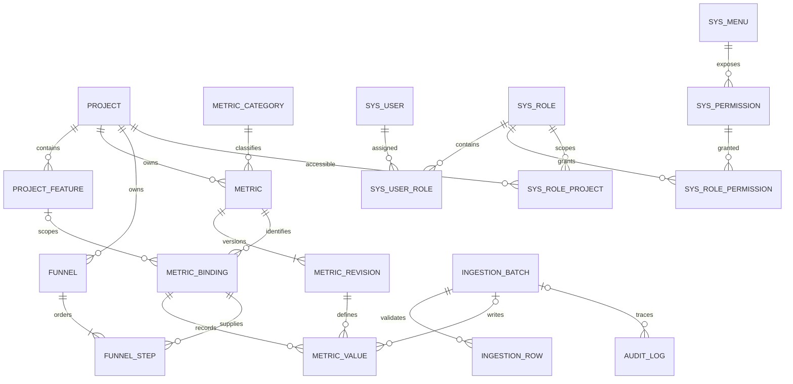

# 多项目 Dashboard · 数据库表结构 v1

> 整理日期：2026-10-30  
> 版本性质：根据当前原型形成的**逻辑模型与字段设计建议**，供开发评审；不是已部署数据库。  
> 数据库产品、ID 生成方式、认证方案及最终 DDL 尚未确定，因此以下类型使用通用 SQL 表达。

## 1. 设计结论与范围

建议首版采用 **19 张核心表**：项目与指标 7 张、漏斗 2 张、用户权限 7 张、导入与审计 3 张；另有 **3 张可选表**，分别用于云文档来源、字段映射和服务端会话。

最主要的数据关系是：

**项目 → 指标定义 → 指标数据项 → 每日数据；漏斗步骤引用指标数据项，首页直接读取每日数据。**

- 指标配置是一条指标对应一个适用项目，不另做“指标—多项目”关系表。同名指标可以用于不同项目；同一项目内不能重复。
- “用户覆盖、用户活跃、使用深度、用户留存、功能使用、性能表现、漏斗指标”统一作为指标的**类型**，与页面当前名称一致。
- “是否关键指标”和“是否展示趋势”是两个独立字段；产险可以有 3 项关键指标，寿险可以有 4 项，不在表结构中固定数量。
- 数据以“项目、统计日、具体指标数据项”为归属。普通指标是一项一值；功能使用指标需要进一步区分客户经营、产品销售等具体功能。
- 漏斗名称、项目、步骤名称、步骤顺序及引用指标均为配置。漏斗转化率由步骤值计算，不再人工维护一套重复的漏斗结果。
- 当前阶段保存人工录入/导入的汇总结果，不假定已取得用户级行为日志、客户明细或成交订单。
- 当前网页中的 localStorage、样例数值和演示回退不作为生产数据库事实。

### 1.1 依据与冲突处理

依据当前 [首页原型](./原型图/Dashboard首页_PC_v1.html)、[数据维护原型](./原型图/Dashboard数据维护_PC_v1.html)、[设置管理原型](./原型图/Dashboard设置管理_PC_v1.html) 及 [项目指标与统计口径](./项目指标与统计口径.xlsx)。

[系统功能框架](./Dashboard系统功能框架.md) 和 [原型设计要求](./Dashboard原型设计.md) 中部分内容停留在旧版。以下以本轮已明确的功能为准：

| 旧描述 | 当前设计采用 |
|---|---|
| 首页下钻项目指标详情 | 单层首页，以项目 Tab、统计日期切换；不再建立“项目指标详情”菜单 |
| 周/月活跃、人均使用次数、对话轮次、次周留存 | 按最新指标表维护；不把旧口径自动迁为新口径 |
| 只有首页主指标开关 | 是否关键指标、是否展示趋势两个独立开关 |
| 未包含漏斗 | 漏斗配置、可编辑步骤、拖动排序、漏斗指标维护 |
| 产险使用相同四项关键指标 | 产险为留存率、成交转化率、成交额；成交相关口径尚待确认 |

原型尚未完成的联动不视为正式业务规则；本文中新增的数据库实现方式均为设计建议。

### 1.2 已提供的部署环境

服务器信息已由你提供，当前资料记录为：腾讯云轻量应用服务器，新加坡，2 核 CPU、4GB 内存、60GB SSD 系统盘，OpenCloudOS 9，已安装 OpenClaw。以上来自已有截图资料，本次未登录服务器核验。

本版按这台服务器上的单机应用与单个关系数据库设计，暂不引入分布式数据库、消息队列、搜索引擎或独立分析库。服务器参数不需要重复提供；尚未确定的是实际采用的数据库软件及其安装/共存方式。保留现有 OpenClaw，不预设重装或覆盖服务。

## 2. 表清单

| 序号 | 表名 | 中文名称 | 主要用途 |
|---|---|---|---|
| 1 | project | 项目表 | 项目名称、状态、首页顺序 |
| 2 | project_feature | 项目功能表 | 各项目的功能清单 |
| 3 | metric_category | 指标类型表 | 七类指标及编码号段 |
| 4 | metric | 指标表 | 指标配置、关键指标、趋势开关 |
| 5 | metric_revision | 指标口径版本表 | 保留名称、单位、口径等历史版本 |
| 6 | metric_binding | 指标数据项表 | 明确指标是项目级，还是某个功能级 |
| 7 | metric_value | 指标每日数据表 | 录入/导入的统一数据事实 |
| 8 | funnel | 漏斗表 | 漏斗名称、项目、状态 |
| 9 | funnel_step | 漏斗步骤表 | 步骤名称、顺序、引用指标数据项 |
| 10 | sys_user | 用户表 | 用户 ID、名称、状态、密码凭证 |
| 11 | sys_role | 角色表 | 角色名称与状态 |
| 12 | sys_user_role | 用户角色关系表 | 一个用户分配多个角色 |
| 13 | sys_menu | 菜单表 | 菜单层级、上级菜单、状态 |
| 14 | sys_permission | 操作权限表 | 查看、编辑、新增、导入、重置密码等 |
| 15 | sys_role_permission | 角色操作权限关系表 | 角色拥有哪些菜单操作权限 |
| 16 | sys_role_project | 角色项目范围关系表 | 角色可以访问哪些项目 |
| 17 | ingestion_batch | 数据写入批次表 | 手工保存、导入及后续同步的批次 |
| 18 | ingestion_row | 导入行结果表 | 逐行校验、错误与跳过结果 |
| 19 | audit_log | 操作与修改日志表 | 修改前后值、操作人、时间与来源 |
| 可选 1 | data_source | 云文档来源表 | 平台与接入方式确认后使用 |
| 可选 2 | data_source_mapping | 来源字段映射表 | 外部列映射到具体指标数据项 |
| 可选 3 | auth_session | 登录会话表 | 若采用服务端会话或持久刷新凭证时使用 |

## 3. 通用字段和存储约定

### 3.1 公共字段

以下 **实体配置表**默认包含公共字段，具体表格不重复展开：`project`、`project_feature`、`metric_category`、`metric`、`funnel`、`sys_user`、`sys_role`、`sys_menu`、`sys_permission`，以及可选的 `data_source`、`data_source_mapping`。

| 字段 | 建议类型 | 空值 | 说明 |
|---|---|---|---|
| id | BIGINT | 否 | 主键；ID 生成方式待数据库选型时确定 |
| created_at | TIMESTAMP | 否 | 创建时间 |
| created_by | BIGINT | 是 | 创建人 → sys_user.id；系统初始化可为空 |
| updated_at | TIMESTAMP | 否 | 最近更新时间 |
| updated_by | BIGINT | 是 | 最近修改人 → sys_user.id |
| row_version | BIGINT | 否 | 乐观锁版本，初始 1，每次修改递增 |

关系表、每日数据表和日志表的字段按各自说明执行，不自动套用上述字段。

### 3.2 数值与日期

- 人数、次数：非负整数；比例：保存 **0～100 的数值**，例如 38.0 表示 38%，不混存 0.38。
- 比例、时长及金额使用定点数，不使用浮点数。本文统一建议 `DECIMAL(24,6)`，写入时按指标的数据种类校验。
- 不把“12,000 人”“38%”“1.24 秒”等带格式字符串存入事实表。
- 没有数据与真实 0 分开：未维护可以没有记录；明确待接入/不适用可以有状态记录且数值为空。
- `stat_date` 为业务统计日。累计指标代表截至该日的快照，不能跨日累加；7 日留存的 `stat_date` 为 D+7 观察日，另记基准日 D。
- 时间戳建议统一按 UTC 保存，统计日按业务时区解释。原型当前按中国日期使用，业务时区建议 `Asia/Shanghai`，不采用服务器所在地区的默认时区来切日。
- 日、周、月去重数据不可互相简单累加。本版不为已移出的旧周/月指标生成值。

## 4. 项目与指标：7 张表

### 4.1 project · 项目表

| 字段 | 建议类型 | 空值 | 说明 |
|---|---|---|---|
| code | VARCHAR(64) | 否 | 稳定项目标识，例如 life、life-office、property |
| name | VARCHAR(100) | 否 | 项目名称 |
| is_enabled | BOOLEAN | 否 | 是否启用 |
| display_order | INT | 否 | 首页项目排序 |
| business_timezone | VARCHAR(64) | 否 | 业务时区；默认值在实施时确认 |

唯一：`code`。索引：`(is_enabled, display_order, id)`。不使用项目名称作为外键。

### 4.2 project_feature · 项目功能表

| 字段 | 建议类型 | 空值 | 说明 |
|---|---|---|---|
| project_id | BIGINT | 否 | → project.id |
| code | VARCHAR(64) | 否 | 项目内稳定功能标识，重命名时保持不变 |
| name | VARCHAR(100) | 否 | 如客户经营、产品销售、问答陪练 |
| display_order | INT | 否 | 功能展示顺序 |
| archived_at | TIMESTAMP | 是 | 从当前清单移除时归档，保留历史数据关系 |

唯一：`(project_id, code)`、`(project_id, name)`；另建唯一 `(project_id, id)` 供跨表项目一致性外键使用。删除已有数据的功能时采用归档，不级联删除数据。

### 4.3 metric_category · 指标类型表

| 字段 | 建议类型 | 空值 | 说明 |
|---|---|---|---|
| code | VARCHAR(32) | 否 | 稳定类型代码 |
| name | VARCHAR(50) | 否 | 类型名称 |
| metric_code_prefix | VARCHAR(16) | 否 | 指标编码前缀 |
| last_sequence | BIGINT | 否 | 已分配最大序号，事务内原子递增 |
| display_order | INT | 否 | 选项排序 |
| is_enabled | BOOLEAN | 否 | 是否可用于新指标 |

唯一：`code`、`name`、`metric_code_prefix`。

| 类型代码建议 | 类型名称 | 现原型编码前缀 |
|---|---|---|
| coverage | 用户覆盖 | YHFG |
| activity | 用户活跃 | YHHY |
| depth | 使用深度 | SYSD |
| retention | 用户留存 | YHLC |
| feature | 功能使用 | GNSY |
| performance | 性能表现 | XNBX |
| funnel | 漏斗指标 | LDZB |

编码分配必须使用数据库事务/原子更新，禁止 `MAX(code)+1` 后无锁插入。前缀加四位序号沿用原型；超出 9999 时不能回绕，是否扩位另行确认。指标停用或归档后不回收编码。

### 4.4 metric · 指标表

| 字段 | 建议类型 | 空值 | 说明 |
|---|---|---|---|
| project_id | BIGINT | 否 | 单个适用项目 → project.id |
| category_id | BIGINT | 否 | 类型 → metric_category.id |
| code | VARCHAR(32) | 否 | 全局唯一指标编码，保存后不修改 |
| name | VARCHAR(100) | 否 | 中文名称 |
| name_key | VARCHAR(100) | 否 | 用于去重的名称；至少去掉首尾空白 |
| english_name | VARCHAR(200) | 是 | 英文缩写／名称 |
| unit | VARCHAR(32) | 是 | 人、次、%、秒、分钟／次等；未确认可以为空 |
| value_kind | VARCHAR(16) | 否 | COUNT、RATE、DURATION、AMOUNT、DECIMAL；用于数值校验 |
| decimal_places | SMALLINT | 否 | 展示精度；COUNT 为 0 |
| currency_code | VARCHAR(3) | 是 | 金额指标的币种；未确认不默认填人民币 |
| scope_kind | VARCHAR(16) | 否 | PROJECT 项目级，FEATURE 功能级 |
| definition | TEXT | 是 | 指标口径；未确认可为空 |
| definition_status | VARCHAR(16) | 否 | PENDING / CONFIRMED，口径状态 |
| retention_window_days | SMALLINT | 是 | 留存指标观察间隔；已确认的 D7 为 7，其他指标为空 |
| current_revision_id | BIGINT | 是 | 当前口径版本 → metric_revision.id；创建事务完成前可暂为空 |
| beidou_metric_code | VARCHAR(100) | 是 | 关联北斗指标，对应现有编辑字段 |
| is_key_metric | BOOLEAN | 否 | 是否关键指标 |
| show_trend | BOOLEAN | 否 | 是否展示趋势；独立于关键指标开关 |
| display_order | INT | 否 | 指标排序，支持关键指标稳定排布 |
| is_enabled | BOOLEAN | 否 | 启用／停用 |
| archived_at | TIMESTAMP | 是 | 移出当前目录时归档，保留历史关系 |

唯一：`code`、`(project_id, name_key)`；另建唯一 `(project_id, id)`。停用不会解除同项目同名约束。名称大小写是否视为相同，在数据库排序规则选定时确认。

索引：`(project_id, is_enabled, display_order, id)`、`(project_id, is_key_metric, is_enabled)`、`(project_id, category_id, is_enabled)`。

注意：`value_kind` 是存储校验属性，**不恢复已移除的“指标类型：累计／期间”页面字段**。日快照、留存日期等语义按指标口径及专用日期字段处理。

编辑类型时编码仍保持不变，因此前缀只代表创建时分配号段，不能用编码前缀代替当前类型字段。当前版本用组合外键 `(id,current_revision_id) → metric_revision(metric_id,id)` 约束，防止指向其他指标的版本。

### 4.5 metric_revision · 指标口径版本表

| 字段 | 建议类型 | 空值 | 说明 |
|---|---|---|---|
| id | BIGINT | 否 | 主键 |
| metric_id | BIGINT | 否 | → metric.id |
| revision_no | INT | 否 | 同一指标递增的版本号 |
| name | VARCHAR(100) | 否 | 当时的指标名称 |
| english_name | VARCHAR(200) | 是 | 当时的英文名称 |
| unit | VARCHAR(32) | 是 | 当时单位 |
| value_kind | VARCHAR(16) | 否 | 当时数值种类 |
| decimal_places | SMALLINT | 否 | 当时精度 |
| currency_code | VARCHAR(3) | 是 | 当时币种 |
| scope_kind | VARCHAR(16) | 否 | 当时统计对象层级 |
| definition | TEXT | 是 | 当时口径 |
| definition_status | VARCHAR(16) | 否 | 当时确认状态 |
| retention_window_days | SMALLINT | 是 | 当时留存间隔 |
| created_at | TIMESTAMP | 否 | 版本生成时间 |
| created_by | BIGINT | 是 | → sys_user.id |

唯一：`(metric_id, revision_no)`；另建唯一 `(metric_id, id)`，用于校验数据引用的版本属于同一指标。

新增指标时建立第 1 版；口径、单位、数值种类、统计对象等有实质变化时产生新版本。历史版本只新增，不覆盖；已有数值不因口径改动被自动重解释。单纯开关变化不生成口径版本，但记录操作日志。

### 4.6 metric_binding · 指标数据项表

这张表解决“同一个功能使用指标，在不同功能下有多条数据”的问题。页面配置指标定义，实际写入时定位到一个确定的数据项。

| 字段 | 建议类型 | 空值 | 说明 |
|---|---|---|---|
| id | BIGINT | 否 | 主键 |
| project_id | BIGINT | 否 | 所属项目 |
| metric_id | BIGINT | 否 | 指标定义 |
| feature_id | BIGINT | 是 | 功能级指标对应的具体功能；项目级为空 |
| subject_key | VARCHAR(80) | 否 | 系统生成：PROJECT 或 FEATURE:{feature_id} |
| created_at | TIMESTAMP | 否 | 创建时间 |
| archived_at | TIMESTAMP | 是 | 数据项不再参与当前配置的时间 |

唯一：`(metric_id, subject_key)`；另建唯一 `(project_id, id)`、`(metric_id, id)`。

外键：`(project_id, metric_id) → metric(project_id, id)`；`(project_id, feature_id) → project_feature(project_id, id)`。PROJECT 数据项必须 `feature_id=NULL`；FEATURE 数据项必须有同项目功能。`subject_key` 由系统推导并校验，不接受用户任意填写。

示例：

| 指标 | 数据项 | 统计日数值示例 |
|---|---|---|
| 日活跃用户数 | PROJECT | 项目当天的 DAU |
| 功能日使用人数 | FEATURE:客户经营的ID | 客户经营当天的使用人数 |
| 功能日使用人数 | FEATURE:产品销售的ID | 产品销售当天的使用人数 |
| 搜索功能曝光数（自定义漏斗指标） | PROJECT | 此项目当天维护的曝光数 |

同一个数据项可以被多个漏斗步骤引用，不重复维护一份数值。

### 4.7 metric_value · 指标每日数据表

| 字段 | 建议类型 | 空值 | 说明 |
|---|---|---|---|
| id | BIGINT | 否 | 主键 |
| project_id | BIGINT | 否 | 冗余项目 ID，用于权限过滤和批次归属约束 |
| binding_id | BIGINT | 否 | → metric_binding.id |
| metric_id | BIGINT | 否 | 指标 ID，用于版本一致性约束 |
| metric_revision_id | BIGINT | 否 | 本次数值所使用的口径版本 |
| stat_date | DATE | 否 | 统计日／累计快照日／留存观察日 |
| baseline_date | DATE | 是 | 留存基准日；非留存指标为空 |
| value_number | DECIMAL(24,6) | 是 | 指标值；0 是有效数值 |
| value_status | VARCHAR(24) | 否 | VALID 有效值、PENDING 待维护/待接入、NOT_APPLICABLE 不适用 |
| status_reason | VARCHAR(255) | 是 | 待接入或不适用的具体原因 |
| is_period_complete | BOOLEAN | 否 | 当日/观察期是否结束，用于显示部分周期数据与留存限制 |
| ingestion_batch_id | BIGINT | 是 | → ingestion_batch.id；已保存的数据关联写入批次 |
| created_at | TIMESTAMP | 否 | 首次写入时间 |
| created_by | BIGINT | 是 | → sys_user.id |
| updated_at | TIMESTAMP | 否 | 最近更新时间 |
| updated_by | BIGINT | 是 | → sys_user.id |
| row_version | BIGINT | 否 | 防止两人同时覆盖数据 |

唯一：**`(binding_id, stat_date)`**。索引：`(project_id, stat_date, metric_id)`、`(stat_date, binding_id)`；常见趋势查询使用唯一索引按数据项+日期范围读取。

组合外键：`(project_id, binding_id) → metric_binding(project_id,id)`、`(project_id, ingestion_batch_id) → ingestion_batch(project_id,id)`；`(metric_id, binding_id) → metric_binding(metric_id,id)`；`(metric_id, metric_revision_id) → metric_revision(metric_id,id)`，防止误引用其他指标的口径。

约束与写入规则：

1. VALID 必须有数值；PENDING / NOT_APPLICABLE 的数值为空。无记录表示未维护。查询时不把 NULL 或无记录转换成 0。
2. COUNT 必须为非负整数，RATE 为 0～100，DURATION/AMOUNT 为非负定点数；校验依据引用的口径版本。
3. 有效会话数为 0 时，平均会话时长不可写成“0 分钟”，应为空并说明无法计算；已有非零均值须同时校验。
4. 7 日留存满足 `stat_date = baseline_date + 7 天`，观察日结束后才能作为有效完整留存展示。不能把旧次周留存记录改名迁移过来。
5. 平均首字响应时长与平均完整响应时长采用相同成功请求口径，完整响应时长不得小于首字响应时长。
6. 当前可以维护最终比例/均值，不强制补造分子、分母或原始请求明细。若将来维护基础数据并自动计算，应另行定义来源和计算规则。
7. 批次写入数值及对应 audit_log 必须在同一事务提交。

## 5. 漏斗配置：2 张表

### 5.1 funnel · 漏斗表

| 字段 | 建议类型 | 空值 | 说明 |
|---|---|---|---|
| project_id | BIGINT | 否 | 适用项目 → project.id |
| name | VARCHAR(100) | 否 | 漏斗名称 |
| name_key | VARCHAR(100) | 否 | 去掉首尾空白后的名称，用于项目内去重 |
| is_enabled | BOOLEAN | 否 | 是否启用 |
| display_order | INT | 否 | 首页漏斗展示顺序 |

唯一：`(project_id, name_key)`；另建唯一 `(project_id,id)`。索引：`(project_id,is_enabled,display_order,id)`。

行版本使用公共 `row_version`；编辑步骤、修改项目、排序等均递增漏斗版本。

### 5.2 funnel_step · 漏斗步骤表

| 字段 | 建议类型 | 空值 | 说明 |
|---|---|---|---|
| id | BIGINT | 否 | 稳定步骤主键；拖动后不变 |
| funnel_id | BIGINT | 否 | → funnel.id |
| project_id | BIGINT | 否 | 冗余项目 ID，用于数据库层约束项目一致性 |
| step_name | VARCHAR(100) | 否 | 步骤名称，可编辑 |
| binding_id | BIGINT | 否 | 引用具体指标数据项 |
| position | INT | 否 | 步骤顺序，从 1 开始连续编号 |
| created_at | TIMESTAMP | 否 | 创建时间 |
| updated_at | TIMESTAMP | 否 | 更新时间 |

唯一：`(funnel_id,position)`。外键：`(project_id,funnel_id) → funnel(project_id,id)`、`(project_id,binding_id) → metric_binding(project_id,id)`。

操作规则：

- 先选择项目，再编辑步骤；提交时再次检查引用指标属于该项目、已启用且未归档，不能只依赖前端下拉过滤。
- 切换适用项目时清空原步骤的指标引用；必须重新选择并通过校验后，整份配置一次保存。
- 拖动只改 position，名称、指标引用和步骤 ID 一起保留；不按步骤名称重新匹配指标。
- 排序更新须在事务内完成并检查 funnel.row_version。存在唯一顺序约束时，可先移动到不冲突的临时序号区间，再更新为最终 1…N，避免交换时中间状态冲突。
- 删除步骤只删配置行，不删除指标及历史数值；同一数据项可以被不同漏斗引用。
- 不再固定为四步，支持目前页面中的动态添加、删除与排序。

**功能级指标的缺口：** 当前步骤选择器只选“指标”，但功能使用指标还区分具体功能。若允许这类指标进入漏斗，应补充功能选择或明确到数据项；未确定具体功能前不能保存为一个模糊的项目级指标引用。此处是需要补齐的交互，不声称原型已经具备。

### 5.3 漏斗展示取数

按 `funnel_step.position` 排序，通过 binding_id 查询所选统计日的 metric_value。

- 第 i 步转化率 = 第 i 步值 / 第 i-1 步值 × 100%。
- 总体转化率 = 最后一步值 / 第一步值 × 100%。
- 分母为 0 或缺失时显示“—”，不写成 0%；任一步缺失时不填造完整漏斗。
- 不单独建“漏斗每日结果表”保存同一组值和转化率，避免指标修改后两份数据不一致。
- 数值不递减时应提示核对，而不是改小数值来配合图形。漏斗步骤是否必须同单位、同统计对象、同观察窗口，是正式配置校验需要确认的规则；不能把人数、金额、百分比直接视为同一转化链。

## 6. 用户与权限：7 张表

### 6.1 sys_user · 用户表

| 字段 | 建议类型 | 空值 | 说明 |
|---|---|---|---|
| login_id | VARCHAR(100) | 否 | 页面“用户ID”，唯一登录账号；与内部 id 区分 |
| display_name | VARCHAR(100) | 否 | 用户名称 |
| password_hash | VARCHAR(255) | 否 | 密码哈希；不保存明文初始密码 |
| is_enabled | BOOLEAN | 否 | 用户启用/停用开关 |
| must_change_password | BOOLEAN | 否 | 初始/重置后要求修改密码，建议的上线规则 |
| password_changed_at | TIMESTAMP | 是 | 最近密码变更时间 |
| auth_version | BIGINT | 否 | 修改密码或停用时递增，用于失效已有登录凭证 |
| last_login_at | TIMESTAMP | 是 | 最近成功登录时间 |

唯一：`login_id`。重置密码时更新哈希、时间与 auth_version，并写日志；初始密码具体策略仍待确认，不能将原型中 `passwordState='initial'` 当作真实密码实现。

### 6.2 sys_role · 角色表

| 字段 | 建议类型 | 空值 | 说明 |
|---|---|---|---|
| code | VARCHAR(64) | 否 | 稳定角色代码 |
| name | VARCHAR(100) | 否 | 角色名称 |
| is_enabled | BOOLEAN | 否 | 启用／停用 |

唯一：`code`；角色名称是否全局唯一需要业务确认，建议首版避免同名角色。

### 6.3 sys_user_role · 用户角色关系表

| 字段 | 建议类型 | 空值 | 说明 |
|---|---|---|---|
| user_id | BIGINT | 否 | → sys_user.id |
| role_id | BIGINT | 否 | → sys_role.id |
| created_at | TIMESTAMP | 否 | 分配时间 |
| created_by | BIGINT | 是 | → sys_user.id |

联合主键：`(user_id,role_id)`。另建索引 `(role_id,user_id)`。一个用户可有多个角色；停用角色不删除分配关系，但不再参与授权。

### 6.4 sys_menu · 菜单表

| 字段 | 建议类型 | 空值 | 说明 |
|---|---|---|---|
| code | VARCHAR(64) | 否 | 稳定菜单代码 |
| parent_id | BIGINT | 是 | 上级菜单 → sys_menu.id，一级为空 |
| name | VARCHAR(100) | 否 | 菜单名称 |
| route_path | VARCHAR(200) | 是 | 对应页面路径；目录节点可为空 |
| display_order | INT | 否 | 同级排序 |
| is_enabled | BOOLEAN | 否 | 菜单启用状态 |

唯一：`code`。索引：`(parent_id,display_order,id)`。层级由 parent_id 推导，无需再保存容易不一致的 level；校验不能成环。

当前菜单树：

```text
首页
数据维护
设置管理
├─ 项目管理
├─ 指标配置
├─ 漏斗配置
└─ 权限配置
   ├─ 菜单管理
   ├─ 角色管理
   └─ 用户管理
```

新增/编辑漏斗是“漏斗配置”的二级业务页面，不另建授权菜单。“项目指标详情”已移除，不再初始化。

### 6.5 sys_permission · 操作权限表

| 字段 | 建议类型 | 空值 | 说明 |
|---|---|---|---|
| menu_id | BIGINT | 否 | → sys_menu.id |
| code | VARCHAR(100) | 否 | 稳定权限代码，例如 metric:edit |
| name | VARCHAR(100) | 否 | 展示名，例如编辑指标 |
| action_key | VARCHAR(64) | 否 | view/create/edit/import/enable/disable/reset_password 等 |
| display_order | INT | 否 | 操作选项排序 |
| is_enabled | BOOLEAN | 否 | 权限项是否启用 |

唯一：`code`、`(menu_id,action_key)`。

| 菜单 | 当前原型对应操作 |
|---|---|
| 首页 | 查看 |
| 数据维护 | 查看、编辑、批量导入、云文档同步 |
| 项目管理 | 查看、新增项目、编辑项目；列表另有启停操作 |
| 指标配置 | 查看、新增指标、编辑指标；列表另有启停、关键指标与趋势开关 |
| 漏斗配置 | 查看、新增漏斗、编辑漏斗、启用、停用 |
| 菜单管理 | 查看、编辑、新增；列表另有启停操作 |
| 角色管理 | 查看、编辑、新增；列表另有启停操作 |
| 用户管理 | 查看、编辑、新增、重置密码；列表另有启停操作 |

菜单管理与角色编辑树都读取本表，不能各自硬编码不同权限项。现原型部分列表操作还没有独立权限项：启停及两个指标开关是归入“编辑”，还是分别授权，需要确认，不能仅有按钮而后端没有校验。

### 6.6 sys_role_permission · 角色权限关系表

| 字段 | 建议类型 | 空值 | 说明 |
|---|---|---|---|
| role_id | BIGINT | 否 | → sys_role.id |
| permission_id | BIGINT | 否 | → sys_permission.id |
| created_at | TIMESTAMP | 否 | 配置时间 |
| created_by | BIGINT | 是 | → sys_user.id |

联合主键：`(role_id,permission_id)`。反向索引 `(permission_id,role_id)`。

不再加一张重复的 role_menu 表。具体菜单由已有操作权限推导；父级目录由可访问子菜单推导，直接访问页面时仍校验对应查看权限。

### 6.7 sys_role_project · 角色项目范围表

| 字段 | 建议类型 | 空值 | 说明 |
|---|---|---|---|
| role_id | BIGINT | 否 | → sys_role.id |
| project_id | BIGINT | 否 | → project.id |
| created_at | TIMESTAMP | 否 | 配置时间 |
| created_by | BIGINT | 是 | → sys_user.id |

联合主键：`(role_id,project_id)`。反向索引 `(project_id,role_id)`。

**建议的项目授权判定：** 对某个项目执行某项操作时，必须存在一个用户拥有的有效角色，**该同一角色同时拥有此操作权限和此项目范围**。不能分别把所有角色的操作权限与项目范围求并集再相乘。

例：角色 A 能编辑项目甲；角色 B 只能查看项目乙。用户同时拥有 A、B，也不能因此编辑项目乙。

全局的用户、角色、菜单管理按全局操作权限校验；新增项目等尚无目标项目的操作需单独定义管理权限。用户停用、角色停用、菜单或权限项停用均应阻止对应操作。是否允许系统管理员绕过项目范围不能默认推定。

## 7. 写入、导入与修改记录：3 张表

### 7.1 ingestion_batch · 数据写入批次表

| 字段 | 建议类型 | 空值 | 说明 |
|---|---|---|---|
| id | BIGINT | 否 | 主键 |
| batch_no | VARCHAR(64) | 否 | 可展示的批次号，唯一 |
| project_id | BIGINT | 否 | 当前原型每次写入限定一个项目 |
| source_type | VARCHAR(24) | 否 | MANUAL、CSV_IMPORT；后续可扩展 XLSX_IMPORT、CLOUD_SYNC |
| data_source_id | BIGINT | 是 | 可选来源配置；云文档启用后才关联 |
| idempotency_key | VARCHAR(128) | 否 | 防止重复提交的请求唯一键，不直接用文件名 |
| status | VARCHAR(24) | 否 | PENDING、VALIDATED、SUCCEEDED、PARTIAL_FAILED、FAILED |
| original_file_name | VARCHAR(255) | 是 | 导入文件原名 |
| file_storage_key | VARCHAR(255) | 是 | 若保存原文件，记录受控存储位置 |
| file_checksum | VARCHAR(128) | 是 | 文件摘要；用于追溯，不单独决定重复覆盖 |
| input_row_count | INT | 否 | 输入行数 |
| success_row_count | INT | 否 | 成功行数 |
| error_row_count | INT | 否 | 错误行数 |
| skipped_row_count | INT | 否 | 跳过行数 |
| written_value_count | INT | 否 | 实际写入的指标值数，一行可能对应多个指标 |
| created_by | BIGINT | 是 | 提交用户 → sys_user.id |
| created_at | TIMESTAMP | 否 | 创建时间 |
| finished_at | TIMESTAMP | 是 | 完成时间 |
| error_summary | TEXT | 是 | 失败摘要，不写入密码或访问令牌 |

唯一：`batch_no`、`idempotency_key`；另建唯一 `(project_id,id)` 约束事实数据的批次项目。索引：`(project_id,created_at,id)`、`(status,created_at)`。

原型当前上传的是 CSV，可使用 Excel 编辑后另存 CSV；不能把它描述成已经支持直接读取 .xlsx。是否支持原生 .xlsx 导入属于后续实现选择。

手工保存按一次提交生成一个批次；导入先校验再提交，只有提交成功才形成有效事实数据。同一请求重复提交返回同一结果。

### 7.2 ingestion_row · 导入行结果表

| 字段 | 建议类型 | 空值 | 说明 |
|---|---|---|---|
| id | BIGINT | 否 | 主键 |
| batch_id | BIGINT | 否 | → ingestion_batch.id |
| row_no | INT | 否 | 文件行号 |
| raw_payload | JSON | 是 | 原始行，限制为本系统指标数据与必要元信息 |
| normalized_payload | JSON | 是 | 解析后日期、数据项及指标值；可能有多个数据项 |
| validation_errors | JSON | 是 | 字段、错误代码、错误原因列表 |
| status | VARCHAR(24) | 否 | VALID、INVALID、SKIPPED、SAVED |
| created_at | TIMESTAMP | 否 | 校验时间 |
| processed_at | TIMESTAMP | 是 | 保存或跳过时间 |

唯一：`(batch_id,row_no)`；索引 `(batch_id,status,row_no)`。

已有同数据项同日数据，原型 CSV 导入默认跳过，手工编辑可以更新；这可作为首版行为参考。云文档与手工数据冲突时的优先级、是否允许导入覆盖，仍需确认，不静默覆盖现有记录。

### 7.3 audit_log · 操作与修改日志表

| 字段 | 建议类型 | 空值 | 说明 |
|---|---|---|---|
| id | BIGINT | 否 | 主键 |
| project_id | BIGINT | 是 | 项目级操作关联项目；全局账号管理可为空 |
| actor_user_id | BIGINT | 是 | 操作人 → sys_user.id；系统任务可为空 |
| source_type | VARCHAR(24) | 否 | MANUAL、CSV_IMPORT、SYSTEM、CLOUD_SYNC 等来源 |
| action_code | VARCHAR(100) | 否 | create/update/enable/disable/reset_password/reorder 等 |
| entity_type | VARCHAR(64) | 否 | metric、metric_value、funnel、user 等业务对象 |
| entity_id | BIGINT | 是 | 对象 ID；失败创建可能没有 ID |
| entity_version | BIGINT | 是 | 对象变更后的行版本，适用时填写 |
| before_payload | JSON | 是 | 修改前的业务字段快照 |
| after_payload | JSON | 是 | 修改后的业务字段快照 |
| batch_id | BIGINT | 是 | → ingestion_batch.id |
| request_id | VARCHAR(100) | 是 | 一次请求的关联标识，用于串联多条变更 |
| result | VARCHAR(16) | 否 | SUCCESS / FAILED |
| error_code | VARCHAR(64) | 是 | 失败原因代码 |
| created_at | TIMESTAMP | 否 | 操作发生时间 |

索引：`(project_id,created_at,id)`、`(entity_type,entity_id,created_at,id)`、`(actor_user_id,created_at,id)`、`(batch_id,id)`。

`project_id`、`actor_user_id`、`batch_id` 使用明确外键。带 batch_id 的日志必须填写 project_id，并以 `(project_id,batch_id)` 校验批次归属；`entity_type + entity_id` 为多态业务引用，由服务端按允许的实体类型验证，不能伪装成一条可指向所有业务表的数据库外键。

这是追加日志，不允许通过普通编辑接口改写。指标值修改日志与事实数据同事务；失败事务的操作结果可另行记失败日志。日志不保存密码、密码哈希、令牌或云文档密钥。密码重置只记录“执行了重置”及结果。

## 8. 可选表：3 张，不默认纳入已接入能力

### 8.1 data_source · 云文档来源表

除公共字段外建议字段：

| 字段 | 建议类型 | 空值 | 说明 |
|---|---|---|---|
| project_id | BIGINT | 否 | → project.id |
| name | VARCHAR(100) | 否 | 来源名称 |
| provider | VARCHAR(64) | 是 | 平台待确认，不预设腾讯/飞书已接入 |
| external_resource_ref | VARCHAR(500) | 是 | 文档或表标识 |
| credential_ref | VARCHAR(255) | 是 | 密钥管理中的凭证引用，不存明文令牌 |
| sync_mode | VARCHAR(24) | 是 | 平台能力确认后定义 |
| sync_config | JSON | 是 | 经允许的同步配置，不存任意 SQL/执行脚本 |
| is_enabled | BOOLEAN | 否 | 是否启用 |

建议唯一 `(project_id,name)`，另建唯一 `(project_id,id)` 供映射及批次校验项目归属。一个来源可以有多条字段映射和多个写入批次。若首版不接云文档，可暂不建本表，并将 ingestion_batch.data_source_id 留为空；真正启用时再补外键。

### 8.2 data_source_mapping · 来源字段映射表

除公共字段外建议字段：

| 字段 | 建议类型 | 空值 | 说明 |
|---|---|---|---|
| data_source_id | BIGINT | 否 | → data_source.id |
| project_id | BIGINT | 否 | 用于约束来源、指标数据项同项目 |
| binding_id | BIGINT | 否 | → metric_binding.id |
| stat_date_field | VARCHAR(100) | 否 | 统计日期来源列 |
| value_field | VARCHAR(100) | 否 | 数值来源列 |
| baseline_date_field | VARCHAR(100) | 是 | 留存基准日列 |
| parser_config | JSON | 是 | 日期格式、数值格式等受控解析规则 |
| is_enabled | BOOLEAN | 否 | 映射是否启用 |

建议唯一：`(data_source_id,binding_id)`。数据库外键确保来源、数据项同项目；具体云文档多表、多列结构确定后再评审映射粒度，不把当前 JSON 当成最终平台契约。

### 8.3 auth_session · 登录会话表

仅在选定认证方案需要持久会话时使用，不能与 JWT 等其他方案强行并存一套重复机制。

| 字段 | 建议类型 | 空值 | 说明 |
|---|---|---|---|
| id | BIGINT | 否 | 主键 |
| user_id | BIGINT | 否 | → sys_user.id |
| credential_hash | VARCHAR(255) | 否 | 会话令牌或刷新凭证的哈希，不存原始令牌 |
| auth_version | BIGINT | 否 | 签发时对应的用户认证版本 |
| created_at | TIMESTAMP | 否 | 创建时间 |
| expires_at | TIMESTAMP | 否 | 失效时间 |
| revoked_at | TIMESTAMP | 是 | 主动失效时间 |

唯一：`credential_hash`。索引：`(user_id,revoked_at,expires_at)`。重置密码/停用用户后，应使旧会话失效；采用其他认证方案时实现等价行为。

## 9. 功能如何落到表

| 功能 | 读取 | 写入 |
|---|---|---|
| 首页项目切换 | project + 有效角色项目范围 | 不写业务事实 |
| 首页关键指标卡 | metric.is_key_metric + binding + 当日 value | 关键指标开关写 metric、audit_log |
| 趋势展示 | metric.show_trend + 日期范围 value | 趋势开关写 metric、audit_log |
| 用户覆盖 | 项目级 binding 的累计快照 value | metric_value |
| 功能使用表 | project_feature + 功能级 binding + value | metric_value |
| 首页漏斗 | funnel + 按顺序 step + 指定日期 value | 转化率计算展示，不重复存结果 |
| 新增/编辑指标 | metric_category、project | metric、metric_revision、binding、audit_log |
| 指标启停 | metric | metric.is_enabled、audit_log |
| 新增/编辑漏斗 | 同项目可用指标及数据项 | funnel、funnel_step、audit_log |
| 漏斗步骤拖动 | funnel_step | position + funnel.row_version + audit_log，事务内保存 |
| 手工指标维护 | 当前项目的启用指标、binding、value | ingestion_batch、value、audit_log |
| 漏斗指标维护 | category=funnel 的当前项目指标 | 同一 metric_value，不另开漏斗专用数值表 |
| CSV 校验/导入 | metric、binding、现有 value | ingestion_batch、ingestion_row、value、audit_log |
| 修改记录 | audit_log + 数据项/指标关联 | 只追加日志 |
| 菜单管理 | sys_menu、sys_permission | 菜单状态及日志；预置操作项是否可新增按产品规则 |
| 角色管理 | role、permission、project | role、role_permission、role_project、audit_log |
| 用户多角色分配 | user、role | user_role、audit_log |
| 重置密码 | user | 密码哈希、认证版本、日志；可选会话撤销 |
| 云文档同步 | 可选来源及映射 | ingestion_batch、row、value、audit_log；平台待接入 |

页面中的上一页、下一页、每页条数，以及当前选择的 Tab/日期是查询或浏览状态，首版不额外建业务表保存。数据库查询必须有稳定排序及总数，权限过滤先于分页。

## 10. 核心关系图



## 11. 数据完整性与实现边界

1. 外键在数据库落地，不只写在注释中；涉及项目的外键使用组合约束，避免把其他项目的功能/指标误关联过来。
2. 指标删除、功能移除、用户/角色/项目停用不级联删除历史事实与日志。日常接口以启停、归档为主。
3. 调整指标单位/口径后，不自动把历史数据转成新单位；须保留并展示版本，重算或迁移另行确认。
4. 项目权限检查覆盖查看、保存、导入、指标配置和漏斗配置；不能只过滤首页项目 Tab。
5. 并发修改使用 row_version；漏斗步骤、指标版本、批量保存及审计在各自事务内保持一致。
6. 不提前增加客户、保单、成交订单、用户行为明细表；当前产品只定义汇总指标。产险成交额不意味着本系统需要成为订单系统。
7. 不为每一项指标、每一个项目或每一天单独建物理表，也不把所有日期值塞进一个不可约束的 JSON 字段。JSON 仅用于导入原始行、错误详情及审计快照等不规则内容。
8. 四类核心页面只读取事实表；生产首页不能沿用原型的“缺失就生成演示数据”回退。

## 12. 评审前仍需确认

| 项目 | 已知情况 | 需要确认的内容 |
|---|---|---|
| 数据库产品 | 尚未选定 | MySQL/PostgreSQL 或其他产品、版本及运维方式；确定后生成 DDL |
| 金额 | 产险新增成交额 | 币种、金额单位、保费/支付/签单等认定范围、退款处理；暂不定公式 |
| 成交转化率 | 产险新增关键指标 | 分子、分母、统计窗口、与漏斗采纳是否有关；不能默认等同 |
| 产险留存率 | 首页当前注明沿用 D7 | 是否正式采用 D7，是否有独立产险口径 |
| 有效会话数 | 最新工作簿口径为空 | 会话有效条件、结束条件、空闲处理；与平均时长是否同一批会话 |
| 功能指标进入漏斗 | 当前只有指标选择 | 如何明确到具体功能数据项 |
| 漏斗可比性 | 所有项目适用指标都可能被选择 | 是否限制同单位、同统计对象、同时间窗口，是否允许比例/均值进入漏斗 |
| 权限项 | 原型操作项与部分按钮未完全拆齐 | 启停、关键指标、趋势开关单独授权还是归入编辑；多角色项目授权规则确认 |
| 初始密码与认证 | 有重置密码需求 | 初始密码策略、首次改密要求、认证与会话实现；不使用演示标记代替 |
| 云文档 | 平台及能力尚未确定 | 平台授权、字段、触发方式、更新冲突规则；可选表不等于已接入 |
| 导入覆盖 | 当前 CSV 已有记录跳过 | 是否增加覆盖模式、跨来源优先级、原生 XLSX 导入 |
| 历史保留 | 需要修改记录 | 审计、原文件、旧版本及导入原始行的留存周期 |

完成以上确认后，可据此生成所选数据库的建表 SQL、字典初始化数据和接口字段定义；本次未操作服务器、未创建真实数据库，也未改动现有 HTML 页面。
